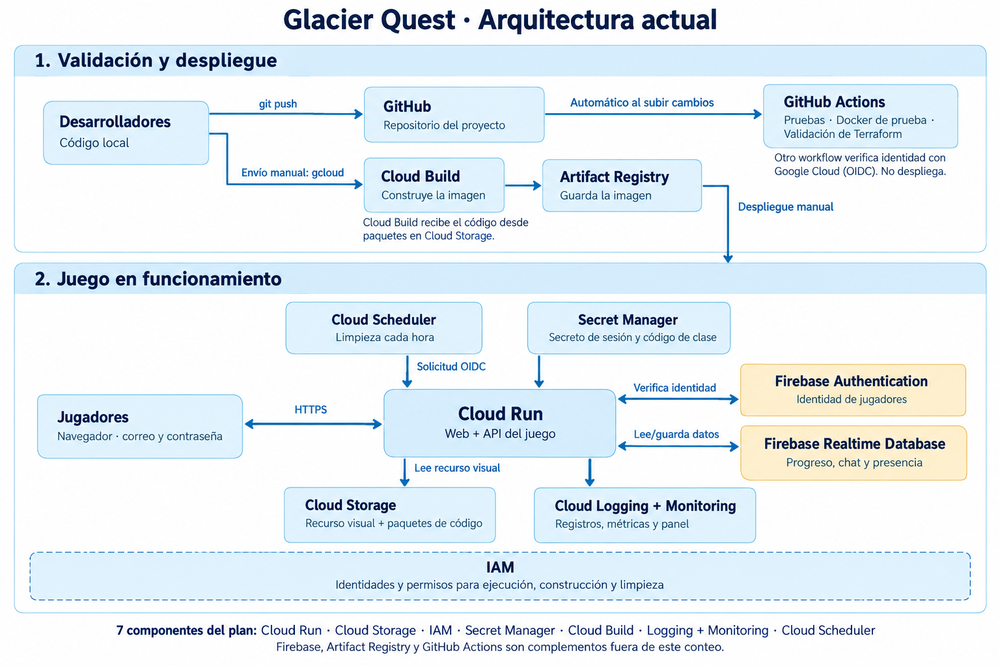

# Glacier Quest

Juego multijugador académico de Cloud Computing: exploración, misiones, recursos renovables, equipo, combate contra enemigos y duelos entre jugadores. Incluye chat, cuentas con correo y progreso persistente.

**Integrantes:** Angel Camargo — 24003664 · Pablo Urbina — 24001508.

**[Abrir el juego](https://glacierquest-demo-636305098699.us-central1.run.app/)**

El acceso requiere el código de clase compartido por los integrantes. No se publica en el repositorio.

## Documentación

El repositorio mantiene tres README:

1. **Este archivo:** presentación, arquitectura y servicios.
2. **[Aplicación](glacierquest/README.md):** instalación, ejecución y código.
3. **[Infraestructura](glacierquest/infra/README.md):** recursos, seguridad, automatización y despliegue.

## Servicios integrados

| Servicio | Función |
| --- | --- |
| Cloud Run | Ejecuta la web y la API del juego. |
| Cloud Storage | Guarda el recurso visual privado y las fuentes de construcción. |
| IAM | Permisos de cuentas de servicio e identidad federada de GitHub. |
| Secret Manager | Proporciona el secreto de sesión y el código de clase. |
| Cloud Build | Construye la imagen del juego mediante el Dockerfile. |
| Cloud Logging + Monitoring | Registros y métricas, agrupados como observabilidad para el conteo académico. |
| Cloud Scheduler | Invoca la limpieza periódica de presencia y mensajes temporales. |

El plan académico cuenta estos siete componentes. Firebase Realtime Database y Authentication complementan la aplicación sin contarse entre los siete, según la autorización comunicada por el docente. Artifact Registry almacena imágenes. GitHub Actions valida el código y tiene una comprobación separada de identidad federada; no despliega automáticamente el juego.

## Flujo del proyecto

[Abrir el diagrama en tamaño completo](glacierquest/docs/architecture-diagram.png). Cloud Run ejecuta la imagen guardada en Artifact Registry; su despliegue se solicita explícitamente. GitHub Actions valida el código por separado.

El navegador accede por HTTPS a Cloud Run. La API valida acciones y guarda progreso, chat y presencia en Realtime Database. Firebase Authentication gestiona las cuentas con correo. El servidor consulta Storage con su cuenta de servicio y recibe secretos desde Secret Manager.

Para actualizar: se valida el código con Actions, se solicita una construcción en Cloud Build, se almacena la imagen en Artifact Registry y se despliega explícitamente su digest en Cloud Run. Scheduler llama a una ruta de mantenimiento autenticada mediante OIDC.

## Alcance

Proyecto: `glacier-quest-1791678996` · Región: `us-central1` · Servicio: `glacierquest-demo`.

Es una demo académica con límites de capacidad, sin pruebas que demuestren 50 mil usuarios. El presupuesto de US$10 configura avisos; no es un corte automático del gasto. Comprobar modalidad de cuenta, saldo y vigencia de créditos en Billing antes de crear o actualizar recursos.

## Video de demostración

Enlace: https://drive.google.com/file/d/1U9DSK01PKNcd2kXBl6JUIRlRvGO4Aqjb/view?usp=sharing
