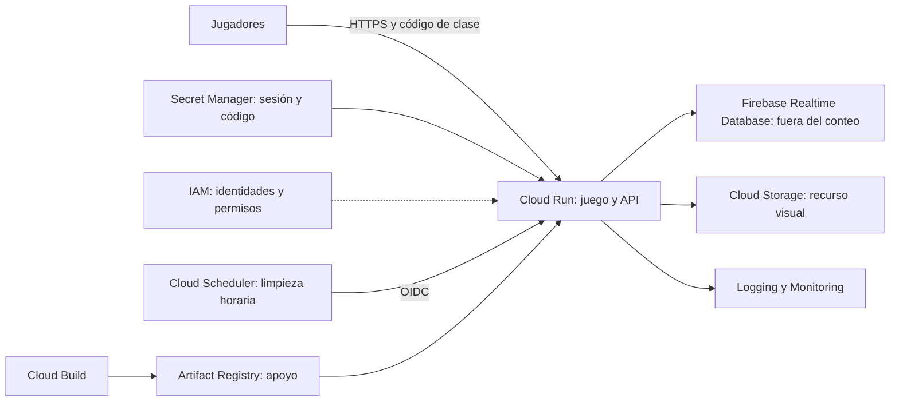

# Firebase como base y Cloud Scheduler en el conteo

Decisión del usuario: el docente permite Firebase como base de datos, pero Firebase
no cuenta entre los siete servicios. Se elige **Firebase Realtime Database**, sin
usar Cloud SQL ni depender de la aprobación anterior de Firestore.

## Estado desplegado

- Proyecto `glacier-quest-1791678996`, cuenta `angelcamargopro2005@gmail.com`.
- Firebase activado después de que el propietario aceptara los términos con esa cuenta.
- Instancia activa `glacier-quest-1791678996-demo`, región `us-central1`.
- Cloud Run usa `STORE=realtime`, revisión `glacierquest-demo-00003-p8q`.
- Build exitoso `0925a305-83e3-457f-9b9f-1eecea2fdb50`.
- Imagen `sha256:ae5c41d2e74c934e0547689ab8cb0c1e13a1ecd6ea8824bbf0317ca76716f026`.
- 21 pruebas locales pasan. La prueba real comprobó jugadores, chat, presencia,
  Storage y monedas persistidas mediante una lectura independiente de Firebase.
  Lectura anónima de la base y limpieza sin autorización: rechazadas.
- Job `glacierquest-cleanup` creado y ejecutado con éxito. La prueba real de OIDC
  verificó que elimina presencia/chat antiguos y conserva presencia reciente y progreso.
  La primera solicitud tardó más que el límite de la prueba durante la configuración
  inicial del servicio; la segunda comprobación pasó y retiró sus datos desechables.
- Se conserva la cuenta de facturación `019891-D38015-39EEC1`. La consola Firebase
  muestra «Blaze a través de la prueba gratuita de Google Cloud», US$300 restantes
  y vencimiento 9 de enero de 2027. El saldo mostrado puede actualizarse con demora.

## Plan de siete servicios, sin contar Firebase

| Servicio | Función concreta | Estado |
| --- | --- | --- |
| Cloud Run | Ejecutar la web y API pública | Desplegado |
| Cloud Storage | Recurso visual privado servido por la API | Integrado |
| IAM | Identidades separadas y permisos de los recursos | Configurado |
| Secret Manager | Clave de sesión y código de clase | Integrado |
| Cloud Build | Construir la imagen con identidad dedicada y logs | Build real exitoso |
| Logging + Monitoring | Trazabilidad, errores, latencia y tráfico | Logs disponibles; falta completar evidencia del panel |
| Cloud Scheduler | Limpieza periódica autenticada de datos temporales | Job horario y prueba real exitosos |

Cloud Scheduler sustituye el lugar de Cloud SQL en el plan académico; **Firebase
sustituye su función de base de datos**. Logging y Monitoring se cuentan juntos.
Artifact Registry apoya el despliegue y GitHub Actions valida el código; no se
requiere contarlos para llegar a siete. La aceptación académica sigue dependiendo
de demostrar cada integración, no simplemente de habilitar su API.



## Datos y seguridad

El navegador conserva el flujo del juego y envía sus acciones a Cloud Run. Solo
el backend obtiene tokens temporales mediante su identidad IAM para consultar
Realtime Database. Las reglas niegan lectura y escritura directa a clientes.
No se colocan claves de servicio en el navegador ni en Git.

La identidad `glacierquest-runtime` usa un rol personalizado con
`firebasedatabase.instances.get` y `firebasedatabase.instances.update`. El usuario
autorizó expresamente el alcance adicional de `update`: también permite modificar
reglas y habilitar/deshabilitar la base. No concede facturación ni crear/eliminar
instancias. La identidad `glacierquest-cleanup` solo se usa para identificar la
invocación de Scheduler; no recibe permisos de base de datos.

El adaptador almacena jugadores, inventario, combate, chat y presencia. Las
mutaciones usan ETag y escrituras condicionales; si dos peticiones compiten por el
mismo turno, se valida otra vez el estado para impedir premios duplicados.
Las lecturas de sala se limitan a 40 presencias y 30 mensajes, con caché de 500 ms.
El cliente consulta cada 1,5 segundos después de terminar la petición anterior;
pausa las solicitudes con la pestaña oculta. Los mensajes propios aparecen cuando
el servidor confirma su guardado, sin esperar la siguiente consulta. Una respuesta
antigua de sala no elimina ni duplica el mensaje recién enviado. Usar Realtime
Database no transforma automáticamente el cliente en un sistema de WebSockets.
El intervalo se redujo desde 5 segundos porque producía retrasos visibles entre
jugadores. Esto puede generar aproximadamente 3,3 veces más consultas mientras
se juega (sin contar la duración de cada petición); se conservan máximo una
instancia de Cloud Run y mínimo cero. No implica gratuidad ilimitada.

Scheduler invoca `/internal/cleanup` con un token OIDC firmado por Google y una
identidad dedicada. La API comprueba destinatario, firma y correo verificado; una
cabecera `X-CloudScheduler` por sí sola no autoriza la acción. La limpieza elimina
presencias con más de un minuto y mensajes con más de siete días. Nunca elimina
jugadores ni progreso. Una escritura condicional evita borrar una presencia que
se haya actualizado mientras se limpiaba.

Frecuencia: minuto 17 de cada hora, zona UTC. Cada ejecución consulta como máximo
20 registros por colección y deja de iniciar peticiones después de 15 segundos;
la petición individual tiene un límite de 10 segundos. La siguiente ejecución
continúa con los registros que queden. Esto es una limpieza gradual, no una
garantía de borrado instantáneo al cumplir siete días.

Persistencia del backend no equivale a un sistema de cuentas: las sesiones actuales
duran siete días y están en sessionStorage del navegador. Recuperar una partida
desde otro dispositivo o después de perder la sesión requerirá autenticación de
jugadores en una etapa posterior.

## Cuotas y facturación

Firebase no es gratis sin límites. El proyecto ya está vinculado a la cuenta de
créditos y usa Cloud Run, por lo que Firebase se mostrará como **Blaze**. La
documentación indica que esto también sucede con la prueba de US$300; lo que ocurra
al agotar el crédito depende de las condiciones de esa prueba. Añadir Firebase
mediante `addFirebase` no modifica la cuenta de facturación del proyecto.

La tabla de precios consultada indica 1 GB de almacenamiento sin costo y, para
Realtime Database en Blaze, 360 MB/día de descargas sin costo (aproximadamente
10 GB/mes). La página narrativa de facturación todavía menciona 10 GB/mes; se usa
el umbral diario más conservador para planificar. Consultar la consola de uso y
la tabla vigente antes de asumir que se dispone de una bolsa mensual acumulable.
El tráfico de conexión también cuenta. No hay garantía de factura cero.

Fuentes oficiales:

- [Precios de Firebase](https://firebase.google.com/pricing).
- [Relación entre Blaze y créditos de Google Cloud](https://firebase.google.com/docs/projects/billing/firebase-pricing-plans).
- [Facturación de Realtime Database](https://firebase.google.com/docs/database/usage/billing).
- [Añadir Firebase y resolver el error 403 / términos](https://firebase.google.com/docs/projects/use-firebase-with-existing-cloud-project).
- [La API addFirebase no modifica la facturación](https://firebase.google.com/docs/reference/firebase-management/rest/v1beta1/projects/addFirebase).

La cuenta de Google Cloud debe mantenerse en prueba gratuita. Las alertas de
US$10 ya configuradas no detienen el consumo automáticamente.

Cloud Scheduler incluye tres jobs sin costo por cuenta de facturación; esta
integración utiliza uno. Cloud Run y Firebase pueden consumir sus propias cuotas
al ejecutar el trabajo. [Precios de Scheduler](https://cloud.google.com/scheduler/pricing).

## Reproducir configuración y comprobaciones

Desde la raíz del repositorio, con gcloud autenticado en la cuenta indicada y la
prueba gratuita comprobada en consola:

```powershell
./glacierquest/infra/demo/configure-firebase.ps1 -Stage Database -TrialVerified
./glacierquest/infra/demo/configure-firebase.ps1 -Stage RuntimeIam -TrialVerified
./glacierquest/infra/demo/deploy.ps1 -Stage Build -TrialVerified -Image <etiqueta-unica>
./glacierquest/infra/demo/deploy.ps1 -Stage Deploy -TrialVerified -Image <imagen-con-digest>
./glacierquest/infra/demo/configure-firebase.ps1 -Stage Scheduler -TrialVerified
python ./glacierquest/infra/demo/verify.py
python ./glacierquest/infra/demo/verify-scheduler.py
```

No ejecutar esos comandos con los marcadores de imagen sin sustituir. Los scripts
fijan cuenta, proyecto, región y facturación esperados. Ninguno actualiza la cuenta
de facturación a pago. `verify.py` crea dos jugadores de prueba; `verify-scheduler.py`
crea y retira solamente sus propios registros desechables de comprobación.

La transición desde memoria requiere volver a entrar con el código de clase si
la sesión anterior ya no encuentra su jugador. No se migran partidas temporales
del proceso anterior. El código de clase y la URL pública se conservan.
