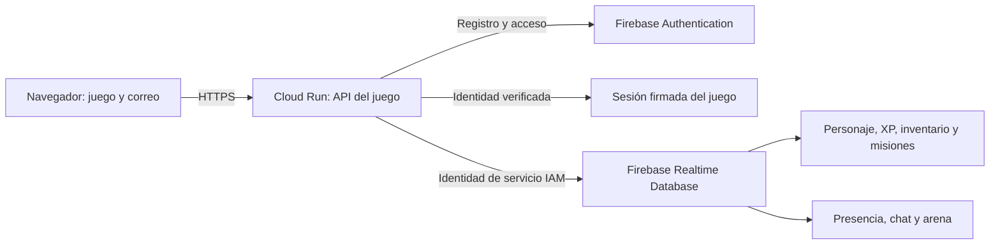

# Expedición Boreal: cuentas, progreso y duelos

Actualización del 16 de octubre de 2026. Proyecto `glacier-quest-1791678996`.

Revisión desplegada: `glacierquest-demo-00005-jz4`. Cloud Build: `80c83639-38e3-43df-8382-85ae2a2b2ce9`. Imagen inmutable: `sha256:a381a23d359c9971cfb501f7e03afed43171cb6a0b65828a97dde23378f820dd`.

[Abrir el juego](https://glacierquest-demo-636305098699.us-central1.run.app/).

## Cómo jugar

1. Selecciona **Crear cuenta**, escribe tu nombre de explorador, correo, contraseña de al menos ocho caracteres y el código de clase que ya utiliza el grupo.
2. Vuelve a entrar con ese correo y contraseña, también desde otro equipo. Firebase conserva nivel, experiencia, inventario, descubrimientos, misiones y victorias.
3. Camina con WASD, flechas o un clic en el mapa. Mantén Shift para correr; consume energía que se recupera al descansar. Pulsa E o **Interactuar** cerca de un lugar.
4. Explora el refugio, lago, bosque, ruinas y arena. El minimapa muestra el mundo completo; la cámara sigue al personaje.
5. En el lago, lanza el anzuelo y recoge cuando aparezca **¡AHORA!**. Hay un tiempo de espera entre lanzamientos. En el refugio recuperas salud.
6. Reclama las recompensas completadas en **Diario**. Recoger objetos, descubrir lugares, pescar y ganar combates otorga experiencia.
7. En **Exploradores**, pulsa **Desafiar** junto a un amigo conectado. El otro jugador debe aceptar. Ambos empiezan con 40 PV: atacar, defender, curar o retirarse. Hay una arena compartida, con un duelo a la vez; las invitaciones duran 45 segundos y cada turno 60 segundos.

La información de servicios está en el engranaje **Estado técnico**. El chat ocupa su propio panel junto al mapa. Se incluyeron controles táctiles y estilos para pantallas pequeñas; la verificación visual de esta entrega se realizó en escritorio.

Si conservas una sesión de invitado de la versión anterior, **Guardar con correo** permite vincular ese personaje al crear una cuenta. Necesitas su sesión válida en ese navegador. Escribir el mismo nombre no recupera personajes; una cuenta ya existente conserva su propio progreso.

## Cómo se guarda

- **Firebase Authentication** administra correo y contraseña. El servidor envía la contraseña a Firebase mediante HTTPS; no la guarda en Realtime Database ni en los logs. El SDK oficial verifica el token de identidad antes de emitir la sesión del juego.
- El personaje usa el identificador `account_<uid de Firebase>`. El correo no se utiliza como clave pública ni se muestra a otros jugadores.
- La sesión del juego dura siete días y se conserva en el navegador. **Salir** la elimina de ese navegador. El nivel se calcula desde la experiencia: `floor(sqrt(xp / 60)) + 1`.
- Realtime Database continúa privada. El navegador habla con la API, y la cuenta de servicio del servidor accede a la base. No se abrieron las reglas para acceso público.
- Las actualizaciones de progreso y arena utilizan ETag para resolver escrituras concurrentes. Los turnos exigen su número de versión y las recompensas de duelo tienen comprobantes para evitar duplicarlas al reintentar.

Rutas de datos: `gq_players`, `gq_presence`, `gq_chat`, `gq_arena/current`. La limpieza programada existente sigue eliminando únicamente presencia caducada y mensajes antiguos, nunca el progreso.

## Configuración y costos

Se habilitó el proveedor **correo/contraseña** de Firebase Authentication y se registró la aplicación web **Glacier Quest Game** en el mismo proyecto. No se activó la actualización opcional a Identity Platform ni se cambió la cuenta de facturación a pago.

Firebase sigue siendo el complemento autorizado fuera del conteo académico. Los siete servicios del plan del documento 08 no cambian: Cloud Run, Cloud Storage, IAM, Secret Manager, Cloud Build, Logging + Monitoring y Cloud Scheduler. Artifact Registry sigue apoyando el despliegue.

Se mantienen cero instancias mínimas, máximo una instancia, 1 CPU y 512 MiB en Cloud Run. La sincronización consulta aproximadamente cada 1,5 segundos, más el tiempo de cada solicitud, y se pausa en pestañas ocultas. Estas restricciones reducen recursos pero **no son un límite monetario**. El uso de Cloud Run, las compilaciones y el tráfico de datos pueden consumir créditos; esta actualización no promete costo cero.

Para desplegar con el script existente se añade `-FirebaseConfigPath` apuntando al JSON de configuración de la aplicación web del proyecto. Se necesitan `FIREBASE_WEB_API_KEY` y `FIREBASE_PROJECT_ID`; la configuración del servidor y referencias a Secret Manager se conservan. No incluir contraseñas, código de clase ni archivos de prueba en Git.

En local, `npm ci --ignore-scripts --prefix api` y `npm start --prefix api`, desde `glacierquest`, permiten usar **Probar sin cuenta**. Ese modo usa memoria y pierde el progreso al detenerse. Los adaptadores antiguos SQL/Firestore permanecen como material de etapas anteriores; el flujo nuevo de cuentas y arena se implementó para memoria y Realtime Database.

## Validación realizada

- 26 pruebas automatizadas de reglas, HTTP, persistencia y concurrencia aprobadas.
- Registro y acceso con Firebase Authentication real, contraseña incorrecta rechazada y recuperación del mismo personaje al volver a entrar.
- Prueba contra Cloud Run y Realtime Database reales: descubrimiento, experiencia persistida, duelo consentido, dos turnos concurrentes con solo uno aceptado y recompensas entregadas una sola vez. Se recuperó nivel 2 al iniciar sesión de nuevo.
- Integraciones existentes comprobadas: Cloud Storage, chat entre jugadores, actualización de posición, secretos referenciados y rechazo de acceso anónimo a la base y al endpoint de limpieza.
- Las cuentas desechables de integración se eliminaron tras la prueba.

## Límites de esta versión

El PvP es por turnos y admite un duelo simultáneo. La presencia usa consultas periódicas, no un servidor de acción en tiempo real; puede existir un pequeño retraso al ver a otros moverse. El mapa tiene cinco zonas dentro de una región continua y sus elementos decorativos no tienen colisiones físicas. Las coordenadas se validan dentro del mapa, pero no hay un sistema antitrampas de velocidad. Es una demo académica para un grupo pequeño.

Referencias técnicas: [Firebase Auth REST](https://firebase.google.com/docs/reference/rest/auth) y [verificación de tokens de identidad](https://firebase.google.com/docs/auth/admin/verify-id-tokens).
