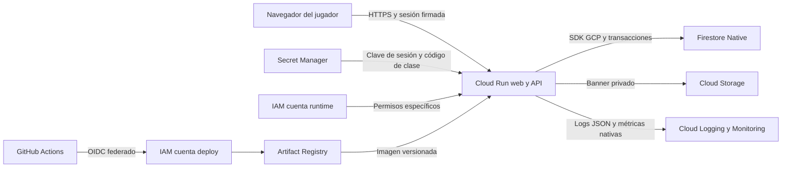

# Arquitectura y servicios

## Decisión

La iteración 0.2 usa Cloud Run para servir la web y la API bajo una sola URL HTTPS. Firestore Native almacena jugadores, inventario, combates, presencia y chat. Cloud Storage conserva un banner privado que la API descarga usando su identidad de servicio. El navegador nunca recibe credenciales de Google.

Las reglas generales del curso permiten explícitamente Firestore vía GCP. La prohibición de Firestore en el playbook es una interpretación incorrecta; se sustituye por el requisito de no usar productos Firebase como sustitutos de los servicios contabilizados. Este proyecto usa `@google-cloud/firestore`, Terraform y GCP, sin Firebase SDK ni Firebase Hosting.

## Matriz de evidencia

| Servicio | Uso concreto | Evidencia de funcionamiento |
|---|---|---|
| Cloud Run | Web y API Express, escala 0 a 2 | URL HTTPS, revisión activa, `/health` con cloud true |
| Firestore Native | Estado y transacciones por jugador | Recoger objeto, recargar y comparar documento; una sola recompensa por turno |
| Cloud Storage | Banner privado servido por API | Objeto en bucket, imagen en juego, comprobación de fuente sin fallback en nube |
| IAM | Cuentas runtime y deploy separadas | Roles por recurso y federación restringida a repositorio, propietario y main |
| Secret Manager | Firma de sesiones y código de clase | Referencias a versiones en Cloud Run, sin mostrar valores |
| Observability | Logging y Monitoring como UN servicio | Petición con requestId en Logs Explorer, panel de peticiones y latencia |
| GitHub Actions | Pruebas, imagen y despliegue a GCP | Ejecución exitosa y nueva revisión con el SHA del commit |
| Artifact Registry | Registro privado de imágenes | Tag SHA, digest y origen de la imagen de Cloud Run |

Se planean ocho servicios distintos. El mínimo de siete no depende de contar Logging y Monitoring por separado. Secret Manager y Artifact Registry pertenecen a seguridad y entrega de software; documentar su integración y confirmar la clasificación con el docente si exige una lista cerrada.

## Modelo de datos y límites

- `players/{uuid}`: nombre, salud, monedas, peces, IDs de objetos recogidos, duelo y marca de último chat. Inventario y duelo usan una transacción por jugador.
- `presence/{uuid}`: posición, nombre y última actividad. El cliente sincroniza cada cinco segundos; desaparece de la sala después de treinta segundos sin actualizar. Se muestran como máximo cuarenta presencias; objetivo de clase: treinta.
- `rooms/plaza`: últimos treinta mensajes. La transacción conserva mensajes concurrentes sin perder escrituras, pero el documento es un punto de contención a mayor escala.
- La sesión firmada dura siete días y vive en `sessionStorage`. Recargar la misma pestaña conserva inventario y duelo. Cerrar la pestaña puede perder el acceso a ese jugador; no es una cuenta con contraseña ni recuperación.
- La posición de presencia es transitoria; al recargar se usa la posición del último evento persistente. Los documentos viejos de jugadores y presencia permanecen y requieren limpieza posterior. No se habilita TTL de pago por defecto.
- Las posiciones se validan por límites y proximidad a objetos. El cliente aún controla sus coordenadas: no hay prevención de teletransporte ni sistema antitrampas. Es una demo de clase, no un mundo competitivo.
- El chat limita mensajes a 140 caracteres y 1 cada 1,5 segundos por jugador. El límite general es por instancia y no reemplaza protección distribuida ni un límite de facturación.

## Qué se simplificó y por qué

Cloud SQL se reemplaza para eliminar la instancia con costo fijo y las credenciales de PostgreSQL. No se migraron datos de una base existente: no se proporcionó una conexión ni se modificó su información. Cloud CDN y su balanceador se eliminan para evitar costos fijos de red. La URL de Cloud Run ya ofrece HTTPS. Vertex AI queda fuera de esta entrega: no es necesario para cubrir el mínimo y la estrategia del enemigo es determinista, reproducible y gratuita.

El banner usa caché en memoria durante cinco minutos por instancia. La comprobación manual de servicios vuelve a leer el objeto: una falla real de Storage se reporta como error. El modo local usa un archivo y lo identifica como tal. La base en memoria se rechaza en producción.

## Prioridad por hitos

M2 del 9 de octubre de 2026: diagrama, proyecto y facturación configurados, dos servicios realmente desplegados como mínimo. Priorizar Cloud Run y Firestore y mostrar persistencia. El despliegue preparado también conecta Storage, secretos e IAM. El código por sí solo no satisface el requisito de dos servicios activos.

Final del 2 de noviembre de 2026: mínimo siete servicios integrados con evidencia, URL pública, PDF, video de cinco a siete minutos y ZIP. Terraform aporta la base para el bonus de IaC; no se debe presentar una validación sintáctica como un despliegue probado.
